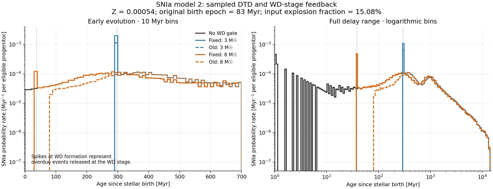

# SNIa model 2 timing correction

The Ruiter DTD supplies a total delay from the original stellar birth, in
years. Sampling occurs when the particle becomes a WD. These are different
time origins: sampling at WD formation does not make the delay a remaining
WD lifetime.

`IndividualStarSetWDLifetime` now converts the sampled delay to code units
and stores it directly as `LifeTime`. It no longer adds `BirthTime`; the
existing feedback trigger already compares `Time > BirthTime + LifeTime`.
The mixed-unit minimum-delay comparison (years against a code-unit timestep)
is removed from model 2.

For a sampled event preceding WD formation, retain the event and its sampled
age. Once the WD is initialized, its overdue event is eligible at the first
feedback check. No extra waiting time, rejection, resampling, or
renormalization is introduced. An event exactly at the current time becomes
eligible after time advances because the existing trigger uses strict `>`.
Actual injection follows the normal feedback scheduling.

Examples, in Myr:

| Birth | WD formation | Sampled total delay | Effective explosion |
| ---: | ---: | ---: | --- |
| 83 | 130 | 30 | First eligible check after WD formation |
| 83 | 130 | 100 | First check with time greater than 183 |

The input DTD, channel sampling, and `IndividualStarSNIaFraction` remain
unchanged. Keeping overdue events preserves their selection probability,
while shifting their realized times to the WD stage. This is an approximate
mapping of a population DTD onto individually evolved stars, not exact
reproduction of its population delay distribution.

Existing WD particles whose lifetimes were assigned by an older executable
retain their saved lifetimes. This correction applies to newly assigned WDs;
it does not reinterpret or repair previously written restart attributes.

Run `python3 tests/snia_timing/check.py`. The test compiles the actual
assignment method and WD feedback branch with controlled DTD draws and
external dependencies. It checks overdue and future events, equal-time
handling, time translation, unit conversion, non-events, the initialization
gate, and that an assigned WD is not resampled. It is not a full restart
I/O or stellar-lifecycle simulation.

Earlier findings in `physics-review.md` describe the pre-fix implementation.
The DTD integration, channel encoding, and stellar mass-boundary findings
are separate from this correction.

Validation on 2026-11-06: the focused regression passed and the configured
newchem Enzo executable rebuilt successfully with the Intel toolchain
(`source /usr/local/intel/oneapi/setvars.sh; make -C src/enzo -j8`).
The build emitted ignored dependency-generation errors; compilation and
linking completed. No galaxy simulation was run for this change.

## Rate comparison



The plot compares the sampled model-2 distribution without a WD gate, the
corrected WD-stage timing for 3 and 8 solar-mass progenitors, and the old
timing for both masses. Rates are probabilities per Myr per eligible
progenitor, not events per solar mass of star formation. Every possible
16-bit uniform draw is enumerated using the actual DTD initialization and
sampling routines, with double precision matching the configured build.
No Monte Carlo realization or galaxy evolution is involved.

Assumptions: metallicity 0.00054, original birth at 83 Myr, and WD formation
at the interpolated PARSEC total lifetime. Those ages are 297.324 Myr for
3 solar masses and 38.372 Myr for 8 solar masses. The exact 8 solar-mass
particle-routing boundary remains unresolved; this curve is conditional on
WD formation. Actual timestep delays at the WD transition are omitted.

On an age-since-birth axis, the corrected feedback age is
`max(WD_age, sampled_delay)`. The old age is
`max(WD_age, birth_epoch + sampled_delay)`. The old mixed-unit floor is
inactive for this comparison (timestep 0.01 code units, one code time unit
equal to one Myr). If birth is at zero, the old and corrected curves coincide.

Overdue events create a probability atom at WD formation, displayed as a
finite-bin spike. In the corrected case, that atom contains 1.9470% of all
3 solar-mass candidates and 0.1144% of all 8 solar-mass candidates. Spike
height depends on bin width; its probability does not. All curves retain
the same total selected probability, 0.1508026123 after RNG discretization.
The fine structure at young ages in the full-range panel reflects finite
RNG and time-table resolution.

Reproduce with:

```sh
python3 tests/snia_timing/plot.py \
  --stellar-table /path/to/parsec_zams.in \
  --metallicity 0.00054 --birth-myr 83
```

The figure is also available as PDF. Binned rate CSVs and the numerical
summary accompany it in `docs/figures/`.
